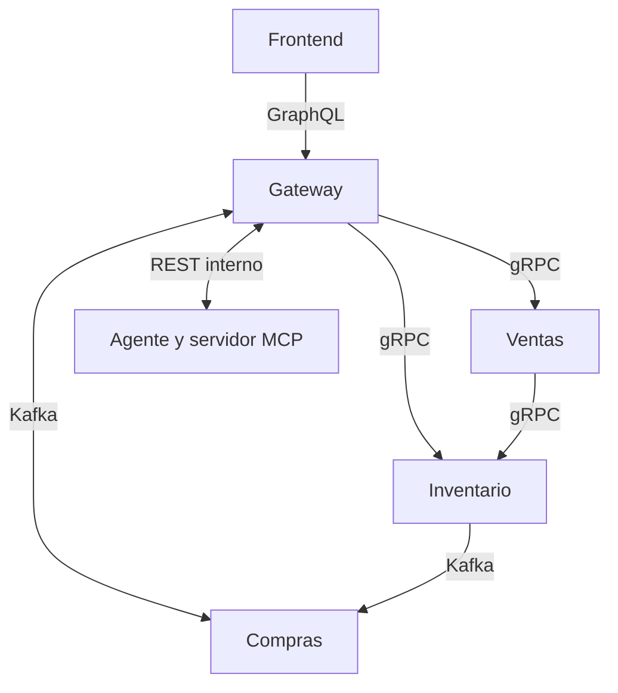

# SmartStock · Infraestructura e integración

Repositorio de integración de SmartStock, una aplicación distribuida para gestionar inventario, ventas y compras con reposición asistida por IA. Centraliza los contratos entre servicios y la configuración para ejecutar el proyecto en local y en Kubernetes.

**Stack** · Docker Compose, Kubernetes con kind, Kustomize, PostgreSQL, Apache Kafka en modo KRaft, GitHub Actions y GHCR.

## Repositorios

Los repositorios se clonan como carpetas hermanas bajo `SmartStock/`.

| Repositorio | Componente |
|---|---|
| `smartstock-inventario` | Microservicio de existencias en Go. |
| `smartstock-ventas` | Microservicio de ventas en Java y Spring Boot. |
| `smartstock-compras` | Microservicio de abastecimiento en C# y .NET. |
| `smartstock-gateway` | API Gateway y BFF en NestJS. |
| `smartstock-front` | Interfaz web en React y TypeScript. |
| `smartstock-mcp` | Agente de reposición y servidor MCP. |
| `smartstock-infra` | Entornos, despliegue y contratos compartidos. |

## Arquitectura

El Gateway expone el acceso al frontend. Inventario, Ventas y Compras mantienen bases PostgreSQL propias. Kafka transporta las alertas de reposición y los mensajes de Compras. El agente usa herramientas MCP para consultar datos y solicitar borradores que el operador puede aprobar.

## Entornos y contratos

- **Docker Compose y Kubernetes.** Previsto para una etapa posterior; este repositorio todavía no contiene configuración de despliegue.
- **Contratos.** `contracts/` contiene las definiciones Protobuf, el esquema GraphQL y el evento de Kafka. Véase [la guía de contratos](contracts/README.md) para sus reglas, distribución y validación.
- **CI e imágenes.** La integración y el consumo de imágenes versionadas quedan pendientes.

Cada repo de aplicación mantiene su código y sus dependencias. Este repo se ocupa de cómo se conectan y ejecutan juntos.
